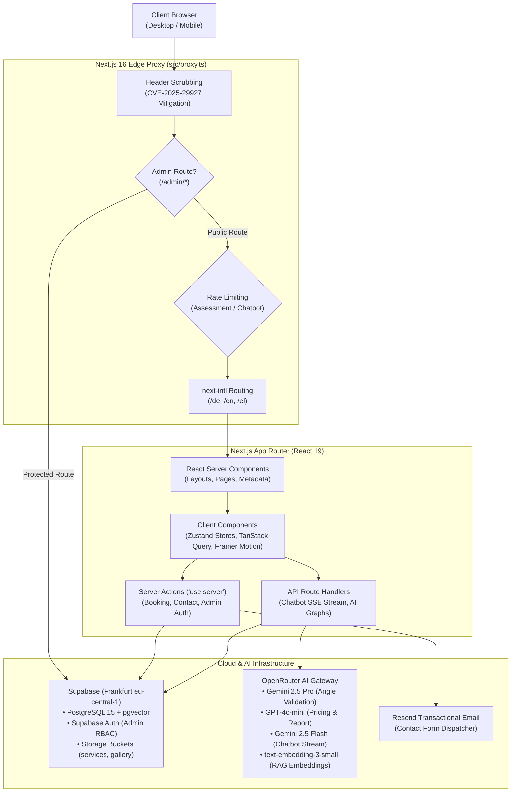

# 🚗 LK Gloss & Detail — Mobile Autopflege & Detailing Platform

[](https://nextjs.org/)
[](https://react.dev/)
[](https://www.typescriptlang.org/)
[](https://tailwindcss.com/)
[](https://supabase.com/)
[](https://langchain-ai.github.io/langgraphjs/)
[](https://vitest.dev/)

> **LK Gloss & Detail** is a state-of-the-art mobile automotive detailing and vehicle reconditioning web platform operating in the Stuttgart metropolitan area (Neuhausen auf den Fildern, Germany). The platform combines luxury branding with cutting-edge AI technologies to deliver automated visual vehicle assessments, dynamic pricing, instant bookings, and multilingual customer support.

---

## 🌟 Key Features

- **📸 Ephemeral AI Car Assessment (`/assessment`)**:
  - Multi-step photo intake (front, rear, side, interior) supporting drag-and-drop and mobile camera capture.
  - Multi-modal visual validation powered by `google/gemini-2.5-pro` via LangGraph to verify photo angles, detect vehicle size (`small`, `medium`, `large`, `suv`), estimate dirt levels (`light`, `moderate`, `heavy`), and ensure car color/model consistency.
  - Client-side RAM-only state management: zero image persistence to databases or permanent storage for maximum privacy.
- **🃏 Tinder-Style Service Swipe Deck**:
  - Interactive touch-friendly swipe card interface with Framer Motion physics.
  - Users swipe right to select detailing services and swipe left to skip.
- **⚡ LangGraph Estimation & Structured Diagnostics Engine**:
  - Stateless AI workflow combining visual findings with database catalog pricing to calculate precise price ranges and durations.
  - Delivers structured diagnostic findings, vehicle health verdict, and immediate booking transition.
- **📅 Concurrency-Safe 4-Step Booking (`/booking`)**:
  - Streamlined booking flow: Client details & GDPR consent $\rightarrow$ Service selection (auto-skipped if arriving from AI assessment) $\rightarrow$ Real-time interactive date picker $\rightarrow$ Glassmorphism confirmation summary.
  - Concurrency & race-condition protection via PostgreSQL `UNIQUE(booking_date)` constraint enforcing one full-day appointment per date.
- **💬 Multilingual RAG AI Chatbot (Floating Widget)**:
  - Vector similarity retrieval against PostgreSQL `chatbot_knowledge` via `extensions.vector` (HNSW cosine distance).
  - OpenRouter `openai/text-embedding-3-small` (1536-dim) embeddings combined with `google/gemini-2.5-flash` streaming (Server-Sent Events).
  - Generates rich Markdown responses with contextual SPA deep links (`/#services`, `/booking`, `/assessment`, `/contact`).
- **🛡️ Secure Admin Control Portal (`/admin`)**:
  - Protected via Next.js 16 Edge Proxy (`src/proxy.ts`) and Supabase Auth with database role verification (`profiles.role = 'admin'`).
  - Appointment calendar with status workflows (`pending`, `confirmed`, `completed`, `cancelled`) and manual full-day date blocking.
  - Complete Services Catalog CRUD with per-vehicle-size pricing, JSONB localization, and image management directly in Supabase Storage.
  - Multilingual AI-assisted Knowledge Base hub: AI drafting across German, English, and Greek, real-time vectorization, and live semantic search tester.
- **🌐 3-Locale Internationalization (`next-intl`)**:
  - Native support for German (`de` - default), English (`en`), and Greek (`el`).
  - Strict routing (`/de/...`, `/en/...`, `/el/...`), dynamic hreflang meta tags, and localized database text fallback.

---

## 🏗️ System Architecture



---

## 💻 Tech Stack

| Layer                    | Technologies                                                                                                                                                                                 |
| :----------------------- | :------------------------------------------------------------------------------------------------------------------------------------------------------------------------------------------- |
| **Framework**            | [Next.js 16.2.9](https://nextjs.org/) (App Router, Turbopack, Edge Proxy)                                                                                                                    |
| **UI & Styling**         | [React 19.2.4](https://react.dev/), [Tailwind CSS v4](https://tailwindcss.com/), [Framer Motion 12](https://motion.dev/), shadcn/ui                                                          |
| **State Management**     | [TanStack React Query v5](https://tanstack.com/query) (Server State), [Zustand v5](https://zustand.docs.pmnd.rs/) (Client/Wizard State)                                                      |
| **Validation**           | [Zod v4](https://zod.dev/) (Runtime schemas for forms, APIs, and AI responses)                                                                                                               |
| **Database & Auth**      | [Supabase](https://supabase.com/) (PostgreSQL 15, `pgvector`, Row Level Security, Storage Buckets)                                                                                           |
| **AI & Orchestration**   | [LangChain.js](https://js.langchain.com/), [LangGraph.js](https://langchain-ai.github.io/langgraphjs/), [OpenRouter](https://openrouter.ai/)                                                 |
| **Internationalization** | [next-intl v4](https://next-intl-docs.vercel.app/) (Locales: `de`, `en`, `el`)                                                                                                               |
| **Email Services**       | [Resend v6](https://resend.com/) + [@react-email/components](https://react.email/)                                                                                                           |
| **Testing & Quality**    | [Vitest v4](https://vitest.dev/), [Playwright v1.62](https://playwright.dev/), [ESLint 9](https://eslint.org/), [Prettier](https://prettier.io/), [Husky](https://typicode.github.io/husky/) |

---

## 🚀 Getting Started

### Prerequisites

- **Node.js**: `v22.x` (LTS recommended, see `.nvmrc`)
- **Package Manager**: `pnpm` (v10.33+ configured in `package.json`)
- **Supabase Project**: PostgreSQL 15 database with `pgvector` enabled in Frankfurt region (`eu-central-1`).
- **OpenRouter Account**: API key with credits for Gemini and OpenAI models.
- **Resend Account**: API key for transactional emails.

### 1. Clone & Install

```bash
git clone https://github.com/Krasimir-Hristov/lk-gloss-detail.git
cd lk-gloss-detail
pnpm install
```

### 2. Environment Configuration

Copy the template file to `.env`:

```bash
cp .env.example .env
```

Open `.env` and populate your credentials. Refer to the [Environment Setup Guide](docs/ENVIRONMENT-SETUP.md) for full instructions on retrieving all keys.

### 3. Database Migrations & Seeding

Deploy all database migrations to your Supabase instance:

```bash
# Push migrations using Supabase CLI
npx supabase db push

# Seed initial services catalog
pnpm tsx scripts/seed-services.ts

# Seed initial chatbot knowledge base (vector embeddings)
pnpm tsx scripts/seed-chatbot.ts

# Create an initial administrator account
pnpm tsx scripts/create-admin.ts admin@lkglossanddetail.de YourSecurePassword123!
```

### 4. Run Development Server

```bash
pnpm dev
```

Open [http://localhost:3000](http://localhost:3000) in your browser. The application will automatically route to the default locale (`/de`).

---

## 📜 Available NPM Scripts

| Script         | Command              | Description                                                  |
| :------------- | :------------------- | :----------------------------------------------------------- |
| `dev`          | `next dev`           | Starts the Next.js development server with Turbopack         |
| `build`        | `next build`         | Compiles the production build                                |
| `start`        | `next start`         | Runs the compiled production server                          |
| `typecheck`    | `tsc --noEmit`       | Runs the TypeScript compiler check across the entire project |
| `lint`         | `eslint`             | Runs ESLint check across all files                           |
| `lint:fix`     | `eslint --fix`       | Automatically fixes ESLint rule violations                   |
| `format`       | `prettier --write .` | Formats all code according to project style guidelines       |
| `format:check` | `prettier --check .` | Verifies formatting compliance without writing changes       |
| `test`         | `vitest run`         | Runs unit and integration test suites                        |
| `test:watch`   | `vitest`             | Runs Vitest in interactive watch mode                        |
| `test:e2e`     | `playwright test`    | Executes end-to-end browser automation test suites           |

---

## 📂 Project Directory Structure

```
lk-gloss-detail/
├── .agents/                    # Workspace agent guidelines & skill definitions
├── .github/                    # GitHub actions, workflows & AI workspace instructions
├── design/                     # Stitch design screenshots, mockups & tokens
├── docs/                       # Comprehensive technical and architecture documentation
├── e2e/                        # Playwright end-to-end test specifications
├── messages/                   # Translation dictionaries (de.json, en.json, el.json)
├── public/                     # Static assets, branding graphics & screenshots
├── scripts/                    # Database seeding, admin setup & maintenance scripts
├── src/
│   ├── actions/                # Server Actions ("use server" for mutations)
│   ├── app/                    # Next.js 16 App Router
│   │   ├── [locale]/           # Localized route tree (de/en/el)
│   │   │   ├── (public)/       # Public pages: home, services, assessment, booking, contact
│   │   │   └── admin/          # Protected Admin Dashboard routes & login
│   │   ├── api/                # API Route handlers (Chatbot streaming, AI endpoints)
│   │   └── globals.css         # Tailwind CSS v4 directives & theme variables
│   ├── components/             # Reusable UI & Layout components
│   │   ├── layout/             # Navbar, Footer, Mobile Drawer
│   │   ├── shared/             # Error boundaries, modals, cookie consent, language switcher
│   │   └── ui/                 # Base design system primitives (shadcn/ui)
│   ├── constants/              # Site configuration, navigation routes, contact info
│   ├── features/               # Domain-driven modular feature packages
│   │   ├── admin/              # Dashboard overview, appointment manager, services CRUD, KB hub
│   │   ├── assessment/         # Multi-step photo intake, Zustand store, swipe deck, report
│   │   ├── booking/            # 4-step booking wizard, state store, calendar picker
│   │   ├── chatbot/            # Floating widget, drawer, message list, streaming hook
│   │   ├── contact/            # Contact form, Google Maps embed, details card
│   │   ├── home/               # Homepage hero, USPs, B2B section, CTA banners
│   │   └── services/           # Services catalog queries and card representations
│   ├── i18n/                   # next-intl request and routing configuration
│   ├── lib/                    # Shared infrastructure utilities
│   │   ├── ai/                 # LangGraph graphs (photo validation & assessment analysis)
│   │   ├── chatbot/            # Embeddings generator & vector utilities
│   │   ├── supabase/           # Client, Server, and Service-role Supabase factories
│   │   └── rateLimit.ts        # In-memory token-bucket rate limiter
│   └── proxy.ts                # Next.js 16 Edge Proxy (No-Middleware pattern)
└── supabase/
    └── migrations/             # SQL version-controlled schema migrations & RLS policies
```

---

## 📐 Mandatory Engineering Standards

Developers contributing to this repository must strictly adhere to the project standards:

1. **Strict No-Middleware Architecture (`src/proxy.ts`)**:
   - Do NOT create `middleware.ts`. All global request handling must be in `src/proxy.ts`.
   - **CVE-2025-29927 Mitigation**: Always strip `x-middleware-subrequest` from external incoming requests.
   - Always duplicate critical authorization checks in Server Components and Server Actions (Defense in Depth).
2. **React 19 & Component Standards**:
   - All React components MUST use **Arrow Function syntax** (`const MyComponent: React.FC<Props> = () => { ... }`). Do not use function declarations for components.
   - Use `next/image` for image optimization and `next/dynamic` for heavy client modules.
3. **Tailwind CSS v4 Classes**:
   - Use modern Tailwind v4 gradient syntax: `bg-linear-to-*` (e.g., `bg-linear-to-b`, `bg-linear-45`) instead of legacy `bg-gradient-to-*`.
4. **Strict TypeScript & Zod Validation**:
   - The use of `any` is strictly FORBIDDEN. All API payloads, Server Action inputs, and store actions must be validated with Zod schemas.
   - All asynchronous calls must be wrapped in `try/catch` with sanitized user-facing error messages.
5. **No Automatic Commits**:
   - Never run automated `git commit` or `git push` commands. Always request explicit user approval before performing git state changes.

---

## 📚 Deep-Dive Documentation Index

Explore the comprehensive guides located in the [`docs/`](docs/) directory:

| Document                                                     | Topic                  | Description                                                                              |
| :----------------------------------------------------------- | :--------------------- | :--------------------------------------------------------------------------------------- |
| 🏛️ [**Architecture Guide**](docs/ARCHITECTURE.md)            | Core System Design     | Edge proxy request pipeline, security scrubbing, RSC architecture & layered boundaries   |
| 🔑 [**Environment Setup**](docs/ENVIRONMENT-SETUP.md)        | Configuration          | Step-by-step setup for Supabase, OpenRouter, Resend, and environment variables           |
| 🗄️ [**Database & Storage**](docs/DATABASE.md)                | Database Schemas       | Complete PostgreSQL 15 schema, pgvector configuration, RLS policies & storage buckets    |
| 📸 [**AI Assessment Flow**](docs/AI-ASSESSMENT-FLOW.md)      | Feature Workflow       | Multi-step photo intake, Gemini angle validation, Tinder swipe deck & LangGraph analysis |
| 📅 [**Booking System Flow**](docs/BOOKING-FLOW.md)           | Feature Workflow       | 4-step wizard, date blocking, Server Actions & race-condition mitigation                 |
| 🤖 [**AI & RAG Architecture**](docs/AI-AND-RAG.md)           | AI Deep Dive           | LangGraph StateGraphs, OpenAI embeddings, vector cosine search & SSE streaming           |
| 🛡️ [**Admin Dashboard Guide**](docs/ADMIN-DASHBOARD.md)      | Administration         | Role-based portal, appointment workflows, services CRUD & AI knowledge base hub          |
| 🌐 [**Internationalization**](docs/I18N-GUIDE.md)            | Localization           | `next-intl` configuration, translation dictionaries, dynamic database localization & SEO |
| 🧪 [**Testing & Quality Assurance**](docs/TESTING-AND-QA.md) | Quality & CI           | Vitest unit testing, Playwright E2E suites, pre-commit hooks & linting standards         |
| 🚢 [**Deployment & DevOps**](docs/DEPLOYMENT-AND-DEVOPS.md)  | Production Ops         | Vercel Frankfurt deployment, DNS records, domain provisioning & performance audits       |
| 🤝 [**Contributing Guide**](docs/CONTRIBUTING.md)            | Developer Onboarding   | Code style rules, git workflows, branching conventions & pull request guidelines         |
| 📋 [**Client Handover Guide**](CLIENT_HANDOVER_GUIDE.md)     | Client Operations (BG) | Step-by-step account transfer and handover guide for Lulezim Kodhimaj                    |

---

## 📄 License & Maintainers

- **Author / Business Owner**: Lulezim Kodhimaj (_LK Gloss & Detail_)
- **Technical Architecture & Development**: Krasimir Hristov
- **Location**: Neuhausen auf den Fildern / Stuttgart Region, Germany
- **Confidentiality**: Proprietary commercial software. All rights reserved.
