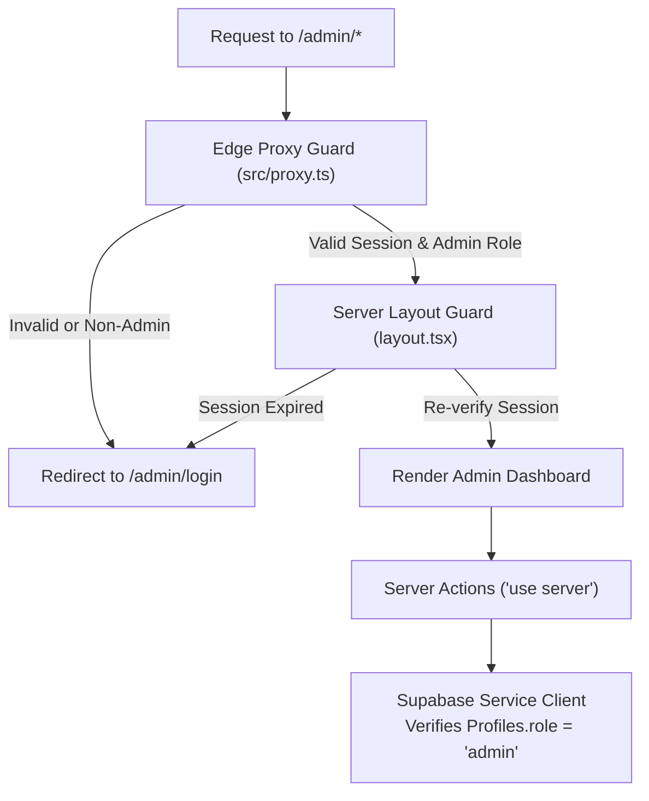
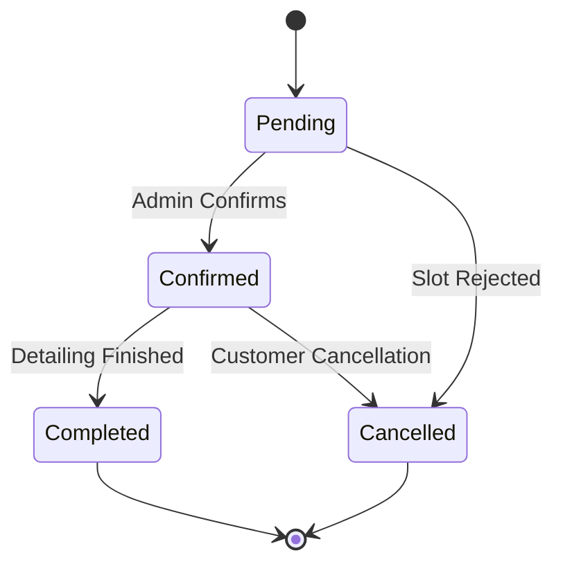
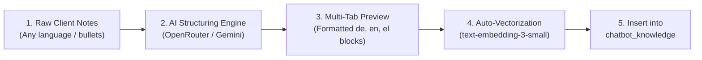

# 🛡️ Admin Dashboard & Management Portal (`/admin`)

> **Comprehensive Guide**: Administrative Operations, Role-Based Access Control, Booking Calendars, Catalog CRUD, and AI Knowledge Base Management  
> **Target Audience**: Business Owner (Lulezim Kodhimaj), Operations Managers, and Full-Stack Developers  
> **Last Updated**: 2026-09-24

---

## 1. Security Architecture & Role-Based Access Control (RBAC)

The administrative control center is strictly protected using a layered defense-in-depth model:



### 1.1 Authentication & Session Lifecycle

- **Login Portal**: Available at `/[locale]/admin/login`.
- **Identity Provider**: Supabase Auth (Email & Password).
- **Elevated Permissions**: An authenticated user must have an explicit record in the `profiles` table with `role = 'admin'`:
  ```sql
  SELECT role FROM profiles WHERE id = auth.uid();
  ```
- **Logout Action**: Triggered via `logoutAdmin` Server Action, clearing active Supabase cookie sessions and redirecting to the localized login portal.

---

## 2. Dashboard Sections & Feature Modules

The admin suite is divided into four primary management modules:

```
src/features/admin/
├── components/
│   ├── layout/            # AdminSidebarNav, AdminMobileHeader
│   ├── overview/          # DashboardMetricsGrid, TodaysAppointmentsWidget, UpcomingAppointmentsWidget
│   ├── appointments/      # AppointmentsCalendar, AppointmentsTable, AppointmentDetailModal, BlockDateModal
│   ├── services/          # ServicesManager, ServicesTable, ServiceModal, DeleteServiceModal
│   └── knowledge/         # KnowledgeBaseManager, KnowledgeModal, SemanticSearchTester
├── schemas/               # Zod validation schemas for services, appointments, and knowledge
└── utils/                 # appointmentHelpers, auth, format utilities
```

---

### 2.1 Overview Dashboard (`/admin`)

The overview screen serves as the daily operational cockpit for the mobile detailing business:

- **Metrics Grid (`DashboardMetricsGrid.tsx`)**:
  - Displays total vehicle assessments completed.
  - Displays monthly new customer inquiries.
- **Today's Appointments (`TodaysAppointmentsWidget.tsx`)**:
  - Highlights appointments scheduled for the current day with customer phone and vehicle info.
- **Upcoming Schedule (`UpcomingAppointmentsWidget.tsx`)**:
  - Lists confirmed appointments over the next 7 calendar days.
- **Quick Actions Bar (`QuickActionsBar.tsx`)**:
  - Shortcuts to immediately block calendar dates or add new knowledge base entries.

---

### 2.2 Appointments & Calendar Manager (`/admin/appointments`)

Controls customer appointments and vehicle reconditioning schedules:



#### Key Capabilities:

- **Dual Presentation Views**:
  - **Calendar View**: Full monthly/weekly grid visualizer highlighting booked and blocked days.
  - **Table View**: Filterable list supporting searches by customer name, email, vehicle, or status.
- **Appointment Detail Modal (`AppointmentDetailModal.tsx`)**:
  - Displays customer contact info (phone, email) with one-click direct dialing/emailing.
  - Shows ordered detailing services and calculated durations.
  - Allows manual status updates (`pending`, `confirmed`, `completed`, `cancelled`).
- **Manual Date Blocking (`BlockDateModal.tsx`)**:
  - Allows the business owner to lock full calendar dates (holidays, personal leave, heavy weather).
  - Inserts directly into `blocked_dates`, immediately disabling the date on the customer booking calendar.

---

### 2.3 Services Catalog CRUD (`/admin/services`)

Enables real-time modification of detailing services, dynamic pricing tiers, and marketing imagery:

- **Multilingual Content Editor (`ServiceModal.tsx`)**:
  - Tabbed interface to edit service names and short descriptions across German (`de`), English (`en`), and Greek (`el`).
- **Dynamic Vehicle Size Pricing**:
  - Adjust base pricing independently for:
    - Small / Compact cars (`price_small`)
    - Medium / Sedans (`price_medium`)
    - Large / Estates (`price_large`)
    - SUVs & Vans (`price_suv`)
  - Configurable estimated duration in hours (`duration_hours`).
- **Direct Supabase Storage Image Upload**:
  - Upload service card hero images directly to the public `services` Supabase Storage bucket.
  - Automatically updates `image_url` on the service record.
- **Visibility Toggle & Deletion**:
  - Instantly hide a service from public cards using the `active` toggle without deleting historical records.
  - Complete deletion modal with automatic orphan cleanup of images from Supabase Storage.

---

### 2.4 AI-Assisted Knowledge Base Hub (`/admin/chatbot-kb`)

Allows non-technical staff to train and expand the customer-facing AI chatbot:



1. **AI-Assisted Draft & Structuring Assistant**:
   - The admin pastes rough bullet points or service policies in plain text.
   - The assistant structures the text into self-contained, RAG-optimized knowledge blocks in German, English, and Greek.
   - Assigns category classifications (`interior`, `exterior`, `paint_correction`, `company_policy`, `general`).
2. **Auto-Vectorization**:
   - On save, entries are vectorized into 1536-dimensional vectors using OpenAI's `text-embedding-3-small`.
   - Records are stored in `chatbot_knowledge` with language tags.
3. **Interactive Semantic Search Tester (`SemanticSearchTester.tsx`)**:
   - Allows administrators to type real-time customer questions into a simulation box.
   - Executes live cosine similarity matching against the database vectors and outputs the retrieved chunks with exact similarity confidence percentages ($0\% - 100\%$).
