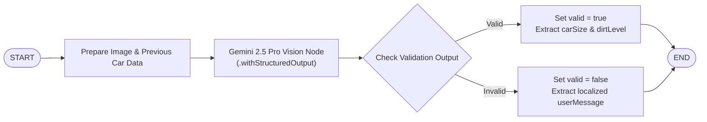
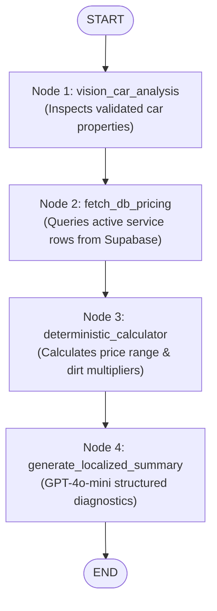
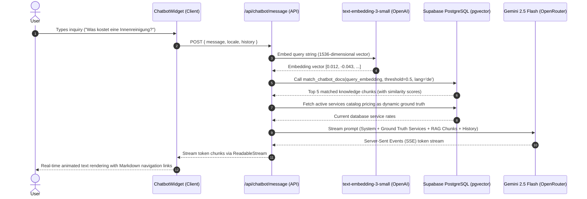

# 🤖 AI & RAG Architecture Deep Dive

> **Technical Specification**: Multi-Model Orchestration, LangGraph StateGraphs, Vector Embeddings, and Streaming RAG  
> **Key Frameworks**: LangChain.js, LangGraph.js, OpenRouter Gateway, Supabase pgvector  
> **Last Updated**: 2026-09-24

---

## 1. Multi-Model Strategy & OpenRouter Gateway

LK Gloss & Detail utilizes [OpenRouter](https://openrouter.ai/) as a centralized AI gateway. This provides high availability, cost efficiency, and the flexibility to assign specific tasks to the most suitable LLM:

| Task / Domain              | Model Identifier                | Provider | Rationale & Strengths                                                                          |
| :------------------------- | :------------------------------ | :------- | :--------------------------------------------------------------------------------------------- |
| **Photo Angle Validation** | `google/gemini-2.5-pro`         | Google   | Exceptional vision reasoning, spatial awareness, and angle consistency detection               |
| **Assessment Diagnostics** | `openai/gpt-4o-mini`            | OpenAI   | Fast, cost-effective structured JSON generation and automotive diagnostic reasoning            |
| **Chatbot Streaming RAG**  | `google/gemini-2.5-flash`       | Google   | Sub-second Time to First Token (TTFT), low cost, and fluent multilingual conversational output |
| **Vector Embeddings**      | `openai/text-embedding-3-small` | OpenAI   | 1536-dimensional semantic representations optimized for dense cosine retrieval                 |

---

## 2. LangGraph StateGraphs

### 2.1 Photo Validation Graph (`src/lib/ai/assessmentValidationGraph.ts`)

The validation graph ensures customer photos strictly adhere to perspective requirements before progressing through the assessment wizard.



#### Structured Output Schema:

```typescript
const ValidationOutputSchema = z.object({
	valid: z.boolean().describe("Whether the photo matches the expected angle"),
	reason: z.string().describe("Internal technical reason for the result"),
	userMessage: z.string().nullable().describe("Friendly localized error message"),
	carSize: z.enum(["small", "medium", "large", "suv"]).nullable(),
	dirtLevel: z.enum(["light", "moderate", "heavy"]).nullable(),
	carDescription: z.string().nullable().describe("Make, model, color notes"),
});
```

#### Validation Logic & Rules:

- **Angle Alignment**: Front (grille/headlights), Rear (taillights/trunk), Side (side profile), Interior (cabin/seats/dashboard).
- **Vehicle Consistency**: Compares current photo with `previousCarDescriptions`. If photo 1 is a "Dark Blue Audi A4" and photo 2 shows a "White VW Golf", validation rejects the second image to maintain assessment integrity.

---

### 2.2 Assessment Analysis Graph (`src/lib/ai/assessmentAnalysisGraph.ts`)

Executes once photos are validated and customer detailing services are selected.



#### Node 3: Deterministic Price & Time Calculation

Prices are never hallucinated by the LLM. Pricing logic is computed deterministically in TypeScript:

```typescript
// Match vehicle size to database column
const sizePriceKey = `price_${carSize}` as keyof PricingRow;
const basePrice = service[sizePriceKey] ?? service.price_medium;

// Apply dirt-level duration multiplier
const dirtMultiplier = dirtLevel === "heavy" ? 1.4 : dirtLevel === "moderate" ? 1.2 : 1.0;
const totalDuration = baseDuration * dirtMultiplier;

// Set investment estimate range
const priceMin = totalBasePrice;
const priceMax = Math.round(totalBasePrice * 1.15);
```

#### Node 4: Structured Diagnostic Output

GPT-4o-mini generates localized technical observations and an authoritative verdict:

```typescript
const AssessmentResultSchema = z.object({
	summaryText: z.string(),
	diagnostics: z.array(
		z.object({
			title: z.string(),
			description: z.string(),
		}),
	),
	expertVerdict: z.string(),
});
```

---

## 3. RAG Chatbot Architecture (`/api/chatbot/message`)

The customer-facing chatbot is designed to provide immediate answers regarding pricing, service techniques, vehicle care advice, and location availability.



### Knowledge Retrieval & PostgreSQL RPC

Semantic search executes directly on PostgreSQL using the cosine distance operator `<=>` powered by an HNSW vector index:

```sql
CREATE INDEX idx_chatbot_knowledge_embedding
ON chatbot_knowledge
USING hnsw (embedding vector_cosine_ops);
```

### Contextual Link Generation

The chatbot system prompt instructs the model to provide seamless internal single-page navigation links formatted in Markdown:

- Services Catalog: `[Unsere Leistungen](/#services)`
- Online Booking: `[Termin buchen](/booking)`
- AI Vehicle Assessment: `[KI-Bewertung starten](/assessment)`
- Contact & Directions: `[Kontakt](/contact)`

The client UI parses these links using `react-markdown` and routes through Next.js client-side navigation (`next/link`).

### Session State Persistence

To prevent conversational loss during page transitions, the `useChatbot` hook stores chat message history and widget open/closed state in `window.sessionStorage`.

---

## 4. Multilingual Translation Service (`src/lib/ai/translation.ts`)

To streamline administrative catalog management, `translateServiceText` translates service titles, descriptions, and knowledge chunks across German (`de`), English (`en`), and Greek (`el`):

- Uses `ChatOpenAI` configured with `google/gemini-2.5-flash`.
- Translates content simultaneously, guaranteeing consistent nomenclature across all three languages.
