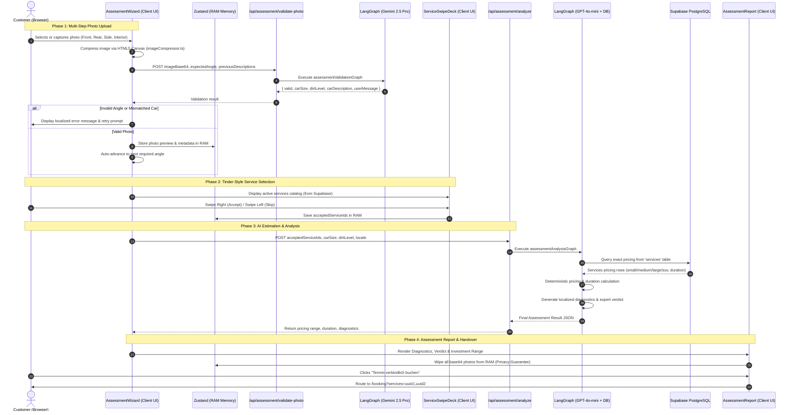

# 📸 AI Car Assessment Workflow (`/assessment`)

> **Executive Summary**: The AI Car Assessment flow allows customers to upload 4 vehicle photos (front, rear, side, interior). A multi-modal LangGraph workflow validates photo angles in real time using `google/gemini-2.5-pro`. Customers then swipe on recommended detailing services via an interactive deck. Finally, an AI analysis graph computes a deterministic price and time estimate based on vehicle size and dirt level, delivering structured diagnostics and an instant booking transition.

---

## 🧩 End-to-End Architecture Overview



---

## 📁 File & Module Reference

| File                                                       | Purpose                                                                                 |
| :--------------------------------------------------------- | :-------------------------------------------------------------------------------------- |
| `src/features/assessment/components/AssessmentWizard.tsx`  | Main flow orchestrator managing steps, transitions, and loading states                  |
| `src/features/assessment/components/PhotoUploadStep.tsx`   | Drag-and-drop file upload, preview, and mobile camera capture (`capture="environment"`) |
| `src/features/assessment/components/ServiceSwipeDeck.tsx`  | Tinder-style swipe container using Framer Motion physics                                |
| `src/features/assessment/components/ServiceSwipeCard.tsx`  | Individual gesture card supporting swipe left (reject) / swipe right (accept)           |
| `src/features/assessment/components/AssessmentReport.tsx`  | Visual summary report presenting AI diagnostics, verdict, and price range               |
| `src/features/assessment/stores/assessmentStore.ts`        | Typed Zustand store managing client-side wizard state and RAM-only photo cache          |
| `src/features/assessment/hooks/useAssessment.ts`           | TanStack Query mutations (`useValidatePhoto`, `useAnalyzeAssessment`)                   |
| `src/features/assessment/schemas/photoValidationSchema.ts` | Zod validation schemas for photo validation requests and LLM structured responses       |
| `src/features/assessment/schemas/assessmentSchema.ts`      | Core domain types and schemas for assessment reports and diagnostics                    |
| `src/features/assessment/utils/imageCompressor.ts`         | Client-side Canvas utility resizing large camera photos to under 1.5MB                  |
| `src/lib/ai/assessmentValidationGraph.ts`                  | LangGraph StateGraph validating photo angles with `google/gemini-2.5-pro`               |
| `src/lib/ai/assessmentAnalysisGraph.ts`                    | LangGraph StateGraph calculating pricing and generating structured diagnostics          |
| `src/app/api/assessment/validate-photo/route.ts`           | API route handler applying rate limiting and executing the validation graph             |
| `src/app/api/assessment/analyze/route.ts`                  | API route handler executing the analysis graph and pricing calculator                   |

---

## 🔄 Detailed Phase Breakdown

### Phase 1: Multi-Step Photo Intake & Validation

1. **Target Perspectives**:
   - `front`: Car front end showing headlights, grille, and bumper.
   - `rear`: Rear perspective showing tail lights and trunk.
   - `side`: Side profile view (slight 3/4 angles permitted).
   - `interior`: Vehicle cabin, dashboard, or upholstery.
2. **Client-Side Image Optimization**:
   Photos taken by modern smartphones can exceed 15MB. Before sending to the API, `imageCompressor.ts` resizes the image via HTML5 `<canvas>` to a maximum dimension of 1600px and 80% JPEG quality, ensuring payloads remain comfortably below Next.js body limits.
3. **AI Validation Graph (`assessmentValidationGraph.ts`)**:
   - Model: `google/gemini-2.5-pro` via OpenRouter.
   - Utilizes LangChain `.withStructuredOutput()` enforcing the following Zod schema:
     ```typescript
     const ValidationOutputSchema = z.object({
     	valid: z.boolean(),
     	reason: z.string(),
     	userMessage: z.string().nullable(),
     	carSize: z.enum(["small", "medium", "large", "suv"]).nullable(),
     	dirtLevel: z.enum(["light", "moderate", "heavy"]).nullable(),
     	carDescription: z.string().nullable(),
     });
     ```
   - **Cross-Photo Consistency**: The API receives previous photo descriptions (e.g., "Silver BMW 3 Series"). If a subsequent photo displays a different vehicle (e.g., "Red Volkswagen Golf"), the model flags the mismatch and asks the user to provide photos of the same car.

---

### Phase 2: Tinder-Style Service Swipe Deck

1. **Service Cards Presentation**:
   - Queries active services from the Supabase database.
   - Displays luxury imagery, localized titles, short descriptions, and base prices.
2. **Gestures & Controls**:
   - **Swipe Right / Accept Button**: Adds the service ID to `acceptedServiceIds` in `assessmentStore.ts`.
   - **Swipe Left / Skip Button**: Excludes the service and advances to the next card.
   - Card deck uses spring physics via Framer Motion with rotation and opacity transitions.

---

### Phase 3: LangGraph Analysis & Pricing Calculation

Once photos are validated and services selected, `AssessmentWizard` calls `/api/assessment/analyze` running `assessmentAnalysisGraph.ts`:

1. **Node 1 (`vision_car_analysis`)**:
   Reads detected `carSize` and `dirtLevel` from the validation phase.
2. **Node 2 (`fetch_db_pricing`)**:
   Queries Supabase `services` table for exact pricing matching `acceptedServiceIds`:
   ```sql
   SELECT id, name, price_small, price_medium, price_large, price_suv, duration_hours
   FROM services WHERE id = ANY(accepted_service_ids);
   ```
3. **Node 3 (`deterministic_calculator`)**:
   - Computes base prices according to detected vehicle size (`price_small`, `price_medium`, `price_large`, or `price_suv`).
   - Applies dirt level multiplier to duration:
     - `light`: $1.0\times$ base hours
     - `moderate`: $1.2\times$ base hours
     - `heavy`: $1.4\times$ base hours
   - Sets estimated investment range: $\text{priceMin} = \text{basePrice}$, $\text{priceMax} = \text{basePrice} \times 1.15$ (to allow for on-site edge cases).
4. **Node 4 (`generate_localized_summary`)**:
   - Model: `openai/gpt-4o-mini` with temperature 0.7.
   - Generates 3–5 structured diagnostic bullets (`diagnostics[]`) explaining specific vehicle care recommendations in the user's language (`de`, `en`, `el`).
   - Produces an authoritative expert verdict quote box.

---

### Phase 4: Assessment Report & Handover to Booking

1. **Report UI Components (`AssessmentReport.tsx`)**:
   - Vehicle Overview Header with car brand and detected size badge.
   - AI Diagnostics Section (detailed bullet points).
   - Expert Verdict Card with glowing purple accent border.
   - Investment Card displaying estimated price range (`€XXX – €YYY`).
   - Estimated timeline in hours.
2. **Data Destruction Guarantee (Privacy First)**:
   ```typescript
   useEffect(() => {
   	// Wipe all raw photo base64 strings from memory immediately upon report load
   	clearPhotosFromMemory();
   }, []);
   ```
   Vehicle photos are never saved to long-term storage or database records. Once analysis is complete, all image data is immediately purged from the browser's memory.
3. **Pre-Filled Booking Link**:
   The primary call to action directs to:
   ```
   /booking?services=<serviceId1>,<serviceId2>
   ```
   The booking wizard detects these query parameters and automatically pre-selects the services while skipping redundant selection steps.
