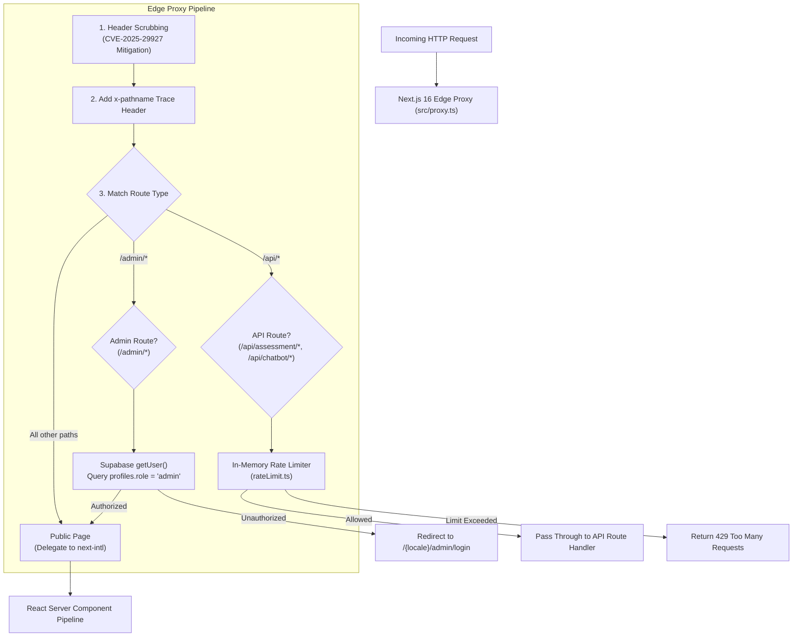
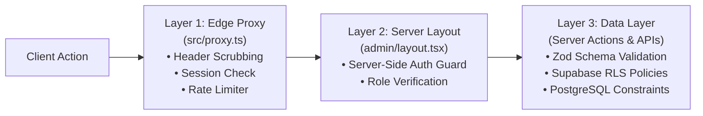

# 🏛️ LK Gloss & Detail — System Architecture & Engineering Standards

> **Architecture Document**: Next.js 16 App Router, React 19, Edge Proxy (`proxy.ts`), Supabase & LangGraph  
> **Status**: Living Architectural Specification  
> **Target Audience**: Core Engineers, Tech Leads, and AI Pair-Programming Agents

---

## 1. High-Level Architectural Principles

LK Gloss & Detail is engineered to deliver high performance, privacy-first AI workflows, and defense-in-depth security. The architecture follows five non-negotiable principles:

1. **Strict No-Middleware Architecture**: In Next.js 16, `middleware.ts` is superseded by `src/proxy.ts` (Custom Server or Edge Proxy). All global request filtering, security sanitization, route protection, and rate limiting must execute strictly within `src/proxy.ts`.
2. **Privacy-First & Ephemeral AI Processing**: Customer vehicle photos uploaded for AI assessment exist solely in client browser memory (RAM) and are never persisted to long-term databases or storage buckets. Once diagnostic analysis completes, raw image buffers are immediately purged.
3. **Defense in Depth**: Security checks are never delegated solely to the edge proxy. Critical operations (such as admin dashboard access and booking mutations) replicate authorization and validation checks across Proxy, Server Components, and Server Actions.
4. **Domain-Driven Feature Isolation**: Code is structured into self-contained feature slices under `src/features/{feature-name}/`. Cross-feature imports must pass exclusively through public barrel files (`index.ts`).
5. **Arrow Function React Standards**: All React components are authored using Arrow Function syntax with strict TypeScript prop contracts. The `function` keyword is reserved for plain utilities.

---

## 2. Request Lifecycle & Edge Proxy (`src/proxy.ts`)



### CVE-2025-29927 Mitigation & Header Filtering

To prevent header spoofing and unauthorized middleware bypasses, `src/proxy.ts` performs defensive header scrubbing on every inbound external request:

```typescript
// Strip internal proxy subrequest headers from incoming client requests
const safeHeaders = new Headers(request.headers);
if (request.headers.has("x-middleware-subrequest")) {
	safeHeaders.delete("x-middleware-subrequest");
}
safeHeaders.set("x-pathname", pathname);
```

### Route Protection & Authentication Guard

Protected administrative routes (`/admin/*`) are intercepted before rendering:

1. Matches pathnames conforming to `/admin/*`, excluding the login portal (`/admin/login`).
2. Initializes `@supabase/ssr` with current request cookies.
3. Calls `supabase.auth.getUser()` to verify active cryptographic JWT sessions.
4. Queries `profiles.role = 'admin'` via database lookup.
5. If invalid or unauthenticated, redirects immediately to `/${locale}/admin/login`.

### Edge Rate Limiting

To defend against automated scraping, DDoS attacks, and unauthorized LLM credit consumption, `src/proxy.ts` implements an in-memory token-bucket rate limiter:

- **Photo Validation (`/api/assessment/validate-photo`)**: 10 requests / minute per IP.
- **Assessment Analysis (`/api/assessment/analyze`)**: 3 requests / 5 minutes per IP.
- **Chatbot Streaming (`/api/chatbot/message`)**: 30 requests / minute per IP.

---

## 3. Application Layers

```
┌─────────────────────────────────────────────────────────────┐
│                    Presentation Layer                       │
│  • React Server Components (RSC) by default                 │
│  • Client Components ('use client') for UI interactivity    │
│  • Tailwind CSS v4 (bg-linear-to-*) + Framer Motion         │
└──────────────────────────────┬──────────────────────────────┘
                               │
┌──────────────────────────────▼──────────────────────────────┐
│                    Feature Modules Layer                    │
│  • src/features/{admin, assessment, booking, chatbot, ...}  │
│  • Isolated components, hooks, schemas, and typed stores    │
│  • Exported solely via index.ts                             │
└──────────────────────────────┬──────────────────────────────┘
                               │
┌──────────────────────────────▼──────────────────────────────┐
│              Data Access & Mutation Layer                   │
│  • Server Actions ("use server"): Form submissions & DB ops  │
│  • Route Handlers (app/api/*): Streaming SSE & AI endpoints │
│  • Universal Zod validation schemas                         │
└──────────────────────────────┬──────────────────────────────┘
                               │
┌──────────────────────────────▼──────────────────────────────┐
│                  Data & External AI Layer                   │
│  • Supabase PostgreSQL 15 + pgvector (HNSW Indexing)        │
│  • Supabase Storage (services, gallery buckets)             │
│  • OpenRouter Multi-Model Gateway                           │
│  • Resend Transactional Email Engine                        │
└─────────────────────────────────────────────────────────────┘
```

---

## 4. State Management Architecture

The project strictly separates server state from client state, eliminating redundant global contexts or heavy state libraries like Redux:

### 1. Server State: `@tanstack/react-query`

- Utilized for client components that read asynchronous data (e.g., active services catalog, calendar unavailable dates).
- Enforces structured caching, background refetching, and predictable query invalidation.

### 2. Client & Wizard State: `zustand`

- Utilized for interactive multi-step flows:
  - `assessmentStore.ts`: Multi-step photo intake, temporary image cache, and Tinder swipe selections.
  - `bookingStore.ts`: Multi-step booking form fields, selected dates, and pre-filled services.
- **RAM Hygiene**: Ephemeral base64 strings stored in Zustand are actively wiped upon mounting the result view (`AssessmentReport.tsx`).

### 3. Runtime Type Validation: `zod`

- All application boundaries (form inputs, route payloads, Server Action parameters, Zustand mutations, and LLM structured responses) validate against strict Zod schemas.

---

## 5. Security Architecture (Defense in Depth)



1. **Layer 1 (Edge Proxy)**: `src/proxy.ts` filters malicious headers, validates sessions for administrative URLs, and blocks excessive requests.
2. **Layer 2 (Server Component Layouts)**: `src/app/[locale]/admin/(dashboard)/layout.tsx` re-verifies session validity and checks `isAdminUser()` before executing layout tree rendering.
3. **Layer 3 (Server Actions & Database)**: Server actions re-parse inputs with Zod and communicate with Supabase using strict Row Level Security (RLS) and database constraints (`UNIQUE(booking_date)`).
