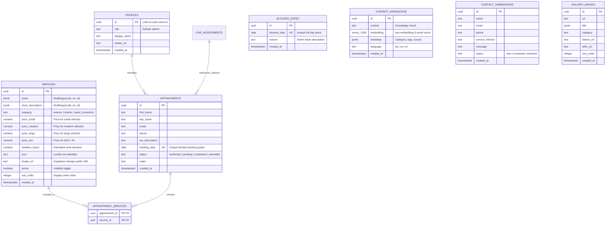

# 🗄️ LK Gloss & Detail — Database & Storage Documentation

> **DB Engine**: PostgreSQL 15 + `pgvector` extension  
> **Host**: Supabase (`eu-central-1` Frankfurt)  
> **Access Layer**: Supabase SSR Client (`@supabase/ssr`), Admin Service Client (`@supabase/supabase-js`), Server Actions  
> **Last Updated**: 2026-09-24

---

## 📐 Entity Relationship (ER) Diagram



---

## 📋 Table Specifications

### 1. `profiles` (Admin Authorization)

Stores elevated role permissions for authenticated Supabase users.

| Column         | Type          | Constraints                                                  | Description                       |
| :------------- | :------------ | :----------------------------------------------------------- | :-------------------------------- |
| `id`           | `UUID`        | `PRIMARY KEY`, `REFERENCES auth.users(id) ON DELETE CASCADE` | Identity ID from Supabase Auth    |
| `role`         | `TEXT`        | `NOT NULL`, `DEFAULT 'admin'`                                | User role for permission checks   |
| `display_name` | `TEXT`        | `NULLABLE`                                                   | Display name of the administrator |
| `avatar_url`   | `TEXT`        | `NULLABLE`                                                   | Profile picture avatar URL        |
| `created_at`   | `TIMESTAMPTZ` | `DEFAULT now()`                                              | Record creation timestamp         |

- **Security & RLS**:
  - `SELECT`: Only authenticated users can read their own profile (`auth.uid() = id`).
  - `ALL`: Admin role verification handled through database functions and `src/proxy.ts`.

---

### 2. `services` (DetaiIing Services Catalog)

Central service definitions featuring per-car-size pricing and JSONB multilingual content.

| Column              | Type            | Constraints                                | Description                                               |
| :------------------ | :-------------- | :----------------------------------------- | :-------------------------------------------------------- |
| `id`                | `UUID`          | `PRIMARY KEY`, `DEFAULT gen_random_uuid()` | Unique service identifier                                 |
| `name`              | `JSONB`         | `NOT NULL`                                 | Localized title: `{"de":"...", "en":"...", "el":"..."}`   |
| `short_description` | `JSONB`         | `NULLABLE`                                 | Localized summary: `{"de":"...", "en":"...", "el":"..."}` |
| `category`          | `TEXT`          | `NOT NULL`, `DEFAULT 'exterior'`           | Service category (`exterior`, `interior`, etc.)           |
| `price_small`       | `NUMERIC(10,2)` | `NOT NULL`, `DEFAULT 0`                    | Price in EUR for compact/small cars                       |
| `price_medium`      | `NUMERIC(10,2)` | `NOT NULL`, `DEFAULT 0`                    | Price in EUR for medium/sedan cars                        |
| `price_large`       | `NUMERIC(10,2)` | `NOT NULL`, `DEFAULT 0`                    | Price in EUR for large/estate cars                        |
| `price_suv`         | `NUMERIC(10,2)` | `NOT NULL`, `DEFAULT 0`                    | Price in EUR for SUVs and vans                            |
| `duration_hours`    | `NUMERIC(4,2)`  | `NOT NULL`, `DEFAULT 1`                    | Estimated work duration in hours                          |
| `icon`              | `TEXT`          | `NULLABLE`                                 | Lucide icon name (e.g., `Car`, `Sparkles`, `Shield`)      |
| `image_url`         | `TEXT`          | `NULLABLE`                                 | Public URL from `services` storage bucket                 |
| `active`            | `BOOLEAN`       | `DEFAULT true`                             | If `false`, hidden from client selection                  |
| `sort_order`        | `INTEGER`       | `DEFAULT 0`                                | Presentation sort priority                                |
| `created_at`        | `TIMESTAMPTZ`   | `DEFAULT now()`                            | Record creation timestamp                                 |

- **Security & RLS**:
  - `SELECT`: Public access allowed for records where `active = true`.
  - `ALL`: Unrestricted access granted to administrators (`profiles.role = 'admin'`).

---

### 3. `blocked_dates` (Manual Calendar Exclusions)

Dates blocked manually by the business owner (holidays, personal days, full capacity).

| Column         | Type          | Constraints                                | Description                                         |
| :------------- | :------------ | :----------------------------------------- | :-------------------------------------------------- |
| `id`           | `UUID`        | `PRIMARY KEY`, `DEFAULT gen_random_uuid()` | Unique record ID                                    |
| `blocked_date` | `DATE`        | `NOT NULL`, `UNIQUE`                       | Blocked calendar date (`YYYY-MM-DD`)                |
| `reason`       | `TEXT`        | `NULLABLE`                                 | Optional note (e.g., "Urlaub", "Equipment Wartung") |
| `created_at`   | `TIMESTAMPTZ` | `DEFAULT now()`                            | Record creation timestamp                           |

- **Indexes**: `idx_blocked_dates_blocked_date` on `(blocked_date)`.
- **Security & RLS**:
  - `SELECT`: Public access (needed by the booking calendar to disable dates).
  - `INSERT / UPDATE / DELETE`: Restricted to administrators.

---

### 4. `appointments` (Customer Bookings)

Customer appointments representing guaranteed single-day detailing bookings.

| Column            | Type          | Constraints                                | Description                                              |
| :---------------- | :------------ | :----------------------------------------- | :------------------------------------------------------- |
| `id`              | `UUID`        | `PRIMARY KEY`, `DEFAULT gen_random_uuid()` | Unique appointment reference                             |
| `first_name`      | `TEXT`        | `NOT NULL`                                 | Customer first name                                      |
| `last_name`       | `TEXT`        | `NOT NULL`                                 | Customer last name                                       |
| `email`           | `TEXT`        | `NOT NULL`                                 | Customer email address                                   |
| `phone`           | `TEXT`        | `NOT NULL`                                 | Customer telephone contact                               |
| `car_description` | `TEXT`        | `NULLABLE`                                 | Make, model, and year notes                              |
| `booking_date`    | `DATE`        | `NOT NULL`, `UNIQUE`                       | **Concurrency Guard**: One confirmed appointment per day |
| `status`          | `TEXT`        | `DEFAULT 'confirmed'`                      | Status: `confirmed`, `pending`, `completed`, `cancelled` |
| `notes`           | `TEXT`        | `NULLABLE`                                 | Internal admin notes or customer requests                |
| `created_at`      | `TIMESTAMPTZ` | `DEFAULT now()`                            | Booking submission timestamp                             |

- **Indexes**: `idx_appointments_booking_date` on `(booking_date)`.
- **Security & RLS**:
  - `INSERT`: Public (anonymous or authenticated) can submit a booking.
  - `SELECT (Client)`: Anonymous users can only query date availability via Server Actions (`getUnavailableDates`). Direct PII access is forbidden.
  - `SELECT / ALL (Admin)`: Full access granted to administrators.

---

### 5. `appointment_services` (Junction Table)

Many-to-many relationship linking appointments with ordered detailing services.

| Column           | Type   | Constraints                                | Description               |
| :--------------- | :----- | :----------------------------------------- | :------------------------ |
| `appointment_id` | `UUID` | `FK -> appointments(id) ON DELETE CASCADE` | Linked appointment ID     |
| `service_id`     | `UUID` | `FK -> services(id) ON DELETE CASCADE`     | Linked service catalog ID |

- **Primary Key**: Composite `(appointment_id, service_id)`.

---

### 6. `chatbot_knowledge` (Vector RAG Knowledge Base)

Multilingual domain knowledge chunks for the AI FAQ assistant.

| Column       | Type           | Constraints                                | Description                                         |
| :----------- | :------------- | :----------------------------------------- | :-------------------------------------------------- |
| `id`         | `UUID`         | `PRIMARY KEY`, `DEFAULT gen_random_uuid()` | Knowledge chunk ID                                  |
| `content`    | `TEXT`         | `NOT NULL`                                 | Raw informational text chunk                        |
| `embedding`  | `vector(1536)` | `NULLABLE`                                 | Vector representation from `text-embedding-3-small` |
| `metadata`   | `JSONB`        | `DEFAULT '{}'`                             | Metadata tags: category, title, source              |
| `language`   | `TEXT`         | `DEFAULT 'de'`                             | Language code (`de`, `en`, `el`)                    |
| `created_at` | `TIMESTAMPTZ`  | `DEFAULT now()`                            | Record creation timestamp                           |

- **Vector Index**:
  ```sql
  CREATE INDEX idx_chatbot_knowledge_embedding
  ON chatbot_knowledge
  USING hnsw (embedding vector_cosine_ops);
  ```

---

### 7. `contact_submissions` (General Inquiries)

Messages submitted through the public contact form (`/contact`).

| Column             | Type          | Constraints                                | Description                                       |
| :----------------- | :------------ | :----------------------------------------- | :------------------------------------------------ |
| `id`               | `UUID`        | `PRIMARY KEY`, `DEFAULT gen_random_uuid()` | Submission ID                                     |
| `name`             | `TEXT`        | `NOT NULL`                                 | Sender's full name                                |
| `email`            | `TEXT`        | `NOT NULL`                                 | Sender's email address                            |
| `phone`            | `TEXT`        | `NULLABLE`                                 | Sender's contact number                           |
| `service_interest` | `TEXT`        | `NULLABLE`                                 | Service category of interest                      |
| `message`          | `TEXT`        | `NOT NULL`                                 | Message body                                      |
| `status`           | `TEXT`        | `DEFAULT 'new'`                            | Processing status: `new`, `contacted`, `archived` |
| `created_at`       | `TIMESTAMPTZ` | `DEFAULT now()`                            | Submission timestamp                              |

---

## ⚙️ PostgreSQL Functions & RPCs

### `match_chatbot_docs` (Cosine Similarity Retrieval)

Performs vector similarity search against the knowledge base filtered by language:

```sql
CREATE OR REPLACE FUNCTION match_chatbot_docs (
    query_embedding vector(1536),
    match_threshold float,
    match_count int,
    filter_language text DEFAULT 'de'
)
RETURNS TABLE (
    id uuid,
    content text,
    metadata jsonb,
    similarity float
)
LANGUAGE plpgsql
SECURITY DEFINER
SET search_path = public, extensions
AS $$
BEGIN
    RETURN QUERY
    SELECT
        chatbot_knowledge.id,
        chatbot_knowledge.content,
        chatbot_knowledge.metadata,
        1 - (chatbot_knowledge.embedding <=> query_embedding) AS similarity
    FROM chatbot_knowledge
    WHERE
        (chatbot_knowledge.language = filter_language OR filter_language IS NULL)
        AND 1 - (chatbot_knowledge.embedding <=> query_embedding) > match_threshold
    ORDER BY chatbot_knowledge.embedding <=> query_embedding
    LIMIT match_count;
END;
$$;
```

---

## 🪣 Supabase Storage Buckets

| Bucket Name             | Public Access    | File Size Limit | Allowed MIME Types                      | Purpose                                                  |
| :---------------------- | :--------------- | :-------------- | :-------------------------------------- | :------------------------------------------------------- |
| `services`              | **Yes** (Public) | 10 MB           | `image/jpeg`, `image/png`, `image/webp` | Detailing service card images and marketing photos       |
| `gallery`               | **Yes** (Public) | 15 MB           | `image/jpeg`, `image/png`, `image/webp` | Portfolio Before / After detailing transformation photos |
| `car-assessment-images` | **No** (Private) | 10 MB           | `image/jpeg`, `image/png`, `image/webp` | Ephemeral customer vehicle assessment photos (RAM-first) |

### Storage RLS Policies

- `services` & `gallery`:
  - `SELECT`: Public access (`bucket_id = 'services'`).
  - `INSERT / UPDATE / DELETE`: Only authenticated users with `profiles.role = 'admin'`.

---

## 🔄 Running Migrations

Database migrations are located in `supabase/migrations/` and version-controlled.

```bash
# Link local project with Supabase cloud instance
npx supabase link --project-ref <your-supabase-ref>

# Push pending SQL migrations
npx supabase db push

# Generate fresh TypeScript database types
npx supabase gen types typescript --local > src/types/supabase.ts
```
