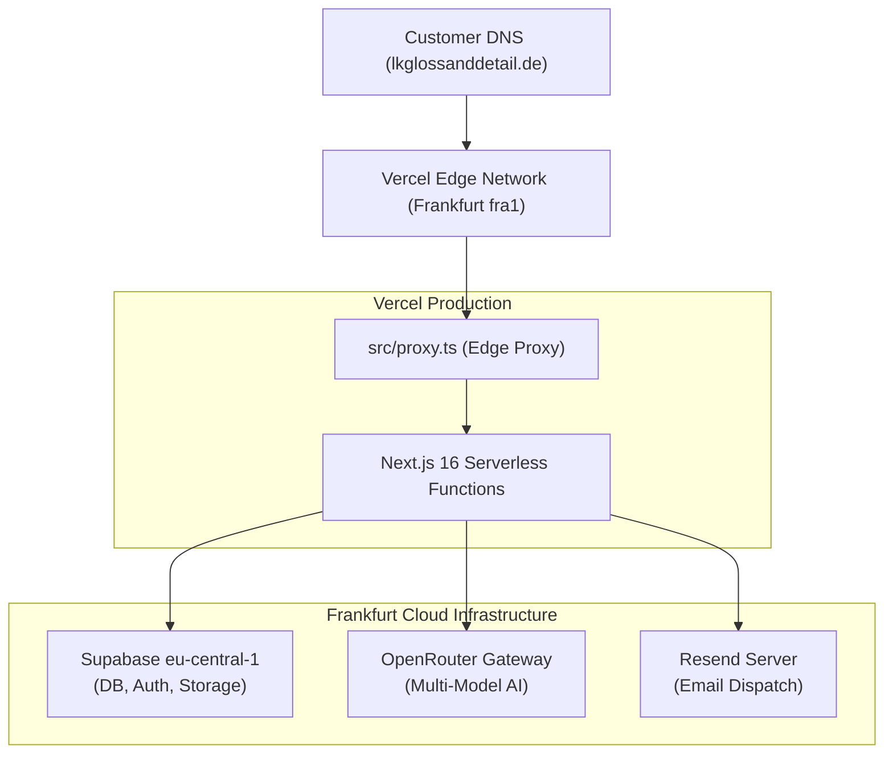

# 🚢 Deployment & DevOps Guide

> **DevOps Manual**: Vercel Production Deployment, DNS Records, Domain Setup, and Production Smoke Testing  
> **Production Target**: Vercel (`fra1` Frankfurt) & Supabase (`eu-central-1` Frankfurt)  
> **Last Updated**: 2026-09-24

---

## 1. Production Architecture Overview

LK Gloss & Detail is engineered to run on a European-centric edge infrastructure ensuring compliance with Germany's DSGVO/GDPR laws and sub-50ms regional latency.



---

## 2. Vercel Deployment Guide

### 2.1 Project Import & Region

1. Log in to [vercel.com](https://vercel.com).
2. Click **Add New...** $\rightarrow$ **Project**.
3. Import the GitHub repository: `Krasimir-Hristov/lk-gloss-detail`.
4. **Framework Preset**: Next.js (automatically detected).
5. **Serverless Region**: Set to **Frankfurt, Germany (`fra1`)** under Project Settings $\rightarrow$ Functions.

### 2.2 Production Environment Variables

Configure the following keys in Vercel under **Settings** $\rightarrow$ **Environment Variables**:

```env
NEXT_PUBLIC_SUPABASE_URL=https://<your-project-ref>.supabase.co
NEXT_PUBLIC_SUPABASE_PUBLISHABLE_KEY=<your-anon-key>
SUPABASE_SECRET_KEY=<your-service-role-key>
OPENROUTER_API_KEY=sk-or-v1-...
OPENROUTER_BASE_URL=https://openrouter.ai/api/v1
RESEND_API_KEY=re_...
CONTACT_EMAIL=info@lkglossanddetail.de
NEXT_PUBLIC_SITE_URL=https://lkglossanddetail.de
```

---

## 3. Custom Domain & DNS Configuration

### 3.1 Vercel Domain Setup

1. In Vercel, navigate to **Settings** $\rightarrow$ **Domains**.
2. Add both root and `www` domains:
   - `lkglossanddetail.de`
   - `www.lkglossanddetail.de`

### 3.2 DNS Records (Registrar: Strato, IONOS, Hetzner, Cloudflare)

Configure the following DNS records at your domain registrar:

| Type      | Name  | Content / Target        | TTL         | Purpose                           |
| :-------- | :---- | :---------------------- | :---------- | :-------------------------------- |
| **A**     | `@`   | `76.76.21.21`           | Auto / 3600 | Points apex domain to Vercel      |
| **CNAME** | `www` | `cname.vercel-dns.com.` | Auto / 3600 | Directs `www` subdomain to Vercel |

### 3.3 Resend Email DNS Records

To authorize Resend to send emails from `@lkglossanddetail.de`:

| Type    | Name                | Content                             | Priority |
| :------ | :------------------ | :---------------------------------- | :------- |
| **TXT** | `resend._domainkey` | `k=rsa; p=...` (Provided by Resend) | -        |
| **TXT** | `_dmarc`            | `v=DMARC1; p=none;`                 | -        |
| **MX**  | `feedback`          | `feedback-smtp.resend.com`          | 10       |

---

## 4. Supabase Production Checklist

Before launching production traffic, verify the following in Supabase Dashboard:

1. **Authentication Redirect URLs**:
   - Go to **Authentication** $\rightarrow$ **URL Configuration**.
   - **Site URL**: `https://lkglossanddetail.de`
   - **Redirect URLs**:
     - `https://lkglossanddetail.de/**`
     - `https://lkglossanddetail.de/admin/login`
2. **Migrations Check**:
   Confirm that all 13 SQL migration files have been applied to production.
3. **Storage Bucket Policies**:
   Verify that `services` and `gallery` buckets are marked **Public**, while `car-assessment-images` is **Private**.
4. **Admin Account Elevation**:
   Ensure the business owner's email account has been assigned `role: 'admin'` in `profiles`:
   ```sql
   INSERT INTO profiles (id, role)
   VALUES ('<USER_UUID>', 'admin')
   ON CONFLICT (id) DO UPDATE SET role = 'admin';
   ```

---

## 5. Post-Deployment Smoke Test (Live Verification)

Following production deployment, conduct this 5-point verification checklist:

1. **🔒 Admin Authentication**:
   - Open `https://lkglossanddetail.de/admin/login`.
   - Log in with production admin credentials and verify redirect to `/admin`.
   - Verify calendar loading and status filters.
2. **📸 AI Assessment Workflow**:
   - Navigate to `/assessment`.
   - Upload 4 test photos (front, rear, side, interior).
   - Verify successful angle validation checkmarks.
   - Swipe right on 2 services and review the generated report.
3. **📅 Concurrency Booking Flow**:
   - Click "Termin verbindlich buchen" from the assessment report.
   - Verify services are pre-selected in Step 2.
   - Select an available date in Step 3 and submit the booking.
   - Confirm successful redirect to `/booking/success?id=...`.
4. **✉️ Contact Form Dispatch**:
   - Submit a test inquiry on `/contact`.
   - Confirm email receipt in the business inbox via Resend.
5. **💬 RAG Chatbot Response**:
   - Open the floating chatbot widget.
   - Ask: _"Was kostet eine Lackkorrektur?"_ in German.
   - Verify streaming Markdown response with clickable internal navigation links.
