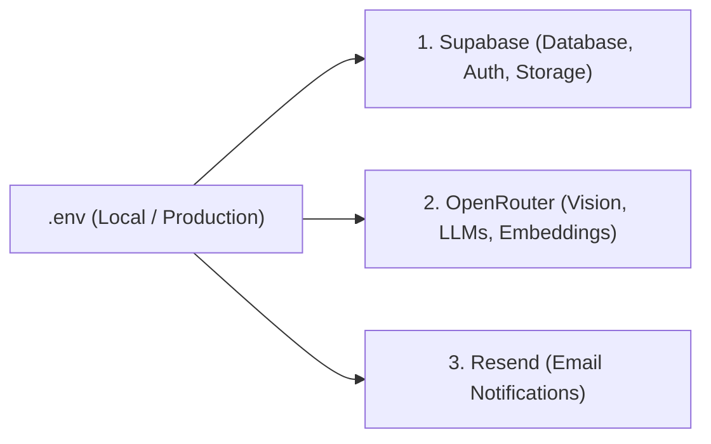

# 🔑 Environment & Third-Party Services Setup Guide

> **Setup Manual**: Configuration Guide for Supabase, OpenRouter, Resend, and Local Development  
> **Target Audience**: Developers, DevOps Engineers, and System Administrators  
> **Last Updated**: 2026-09-24

---

## 1. Overview & Setup Checklist

To run LK Gloss & Detail locally or in production, you require active credentials for three core external providers:



---

## 2. Step-by-Step Provider Setup

### 2.1 Supabase (PostgreSQL, Auth, Storage, pgvector)

1. **Create Project**:
   - Navigate to [supabase.com](https://supabase.com) and create a new project.
   - **Name**: `lk-gloss-detail`
   - **Region**: Choose **Frankfurt (`eu-central-1`)** (Mandatory for GDPR / DSGVO data residency in Germany and low network latency).
   - Set a strong database password and securely record it.
2. **Retrieve API Keys**:
   - In your Supabase Dashboard, go to **Project Settings** $\rightarrow$ **API**.
   - Copy **Project URL** $\rightarrow$ `NEXT_PUBLIC_SUPABASE_URL`
   - Copy **anon public** key $\rightarrow$ `NEXT_PUBLIC_SUPABASE_PUBLISHABLE_KEY` (and `NEXT_PUBLIC_SUPABASE_ANON_KEY`)
   - Copy **service_role** key $\rightarrow$ `SUPABASE_SECRET_KEY` (and `SUPABASE_SERVICE_ROLE_KEY`)
     > [!CAUTION]
     > The `service_role` key bypasses all Row Level Security. Never commit it to git or use it in client-side code!
3. **Deploy Migrations**:
   ```bash
   npx supabase link --project-ref <your-supabase-ref>
   npx supabase db push
   ```
4. **Create Storage Buckets**:
   In the Supabase console, go to **Storage** and ensure the following buckets exist:
   - `services` (Public: **Yes**) — For detailing service card hero images
   - `gallery` (Public: **Yes**) — For Before/After transformation photos
   - `car-assessment-images` (Public: **No**) — Private customer photo intake
5. **Configure Auth URLs**:
   Under **Authentication** $\rightarrow$ **URL Configuration**:
   - **Site URL**: `http://localhost:3000` (or `https://lkglossanddetail.de` in production)
   - **Redirect URLs**: Add `http://localhost:3000/**` and `https://lkglossanddetail.de/**`

---

### 2.2 OpenRouter (AI Models & Embeddings)

1. **Account & Credits**:
   - Register at [openrouter.ai](https://openrouter.ai).
   - Navigate to **Credits** and top up \$5 to \$10. Because the application utilizes cost-effective models (`gemini-2.5-flash`, `gpt-4o-mini`, and `text-embedding-3-small`), a \$10 balance covers thousands of user assessments and chatbot sessions.
2. **Generate API Key**:
   - Go to **Keys** $\rightarrow$ **Create Key**.
   - Name: `LK Detail Development` (or `LK Detail Production`).
   - Copy the key $\rightarrow$ `OPENROUTER_API_KEY`.
3. **Endpoint**:
   - Set `OPENROUTER_BASE_URL=https://openrouter.ai/api/v1`.

---

### 2.3 Resend (Transactional Email)

1. **Account Registration**:
   - Sign up at [resend.com](https://resend.com).
2. **Generate API Key**:
   - Navigate to **API Keys** $\rightarrow$ **Create API Key**.
   - Copy the key $\rightarrow$ `RESEND_API_KEY`.
3. **Verify Custom Domain (For Production)**:
   - Go to **Domains** $\rightarrow$ **Add Domain** (e.g. `lkglossanddetail.de`).
   - Resend provides three DNS records (DKIM, SPF, MX).
   - Add these records to your domain DNS registrar (IONOS, Strato, Cloudflare, etc.).
   - Click **Verify Domain**.
4. **Configure Recipient**:
   - Set `CONTACT_EMAIL` to the business owner's email address where inquiries should be received.

---

## 3. Environment Variables Reference Table

| Variable Name                          | Environment     | Required | Description                                               |
| :------------------------------------- | :-------------- | :------- | :-------------------------------------------------------- |
| `NEXT_PUBLIC_SUPABASE_URL`             | Client & Server | **Yes**  | HTTPS URL of your Supabase project                        |
| `NEXT_PUBLIC_SUPABASE_PUBLISHABLE_KEY` | Client & Server | **Yes**  | Public anonymous API key                                  |
| `NEXT_PUBLIC_SUPABASE_ANON_KEY`        | Client & Server | Optional | Alias for publishable key                                 |
| `SUPABASE_SECRET_KEY`                  | Server Only     | **Yes**  | Privileged service_role secret key                        |
| `SUPABASE_SERVICE_ROLE_KEY`            | Server Only     | Optional | Alias for service role key                                |
| `OPENROUTER_API_KEY`                   | Server Only     | **Yes**  | OpenRouter gateway authentication key                     |
| `OPENROUTER_BASE_URL`                  | Server Only     | **Yes**  | `https://openrouter.ai/api/v1`                            |
| `RESEND_API_KEY`                       | Server Only     | **Yes**  | Resend email API key                                      |
| `CONTACT_EMAIL`                        | Server Only     | **Yes**  | Destination email for contact form submissions            |
| `NEXT_PUBLIC_SITE_URL`                 | Client & Server | **Yes**  | Canonical site URL (`http://localhost:3000` / production) |
| `ADMIN_EMAIL`                          | Script Only     | Optional | Used by `scripts/create-admin.ts`                         |
| `ADMIN_PASSWORD`                       | Script Only     | Optional | Used by `scripts/create-admin.ts`                         |
| `LANGSMITH_TRACING`                    | Server Only     | Optional | Set to `true` to enable LangSmith tracing                 |
| `LANGSMITH_API_KEY`                    | Server Only     | Optional | API key from LangChain LangSmith                          |

---

## 4. Verification & Testing Database Connection

Run the built-in database check script to verify credentials and table availability:

```bash
pnpm tsx scripts/test-db.ts
```

If configured properly, the script will output the number of active services in your database without errors.
