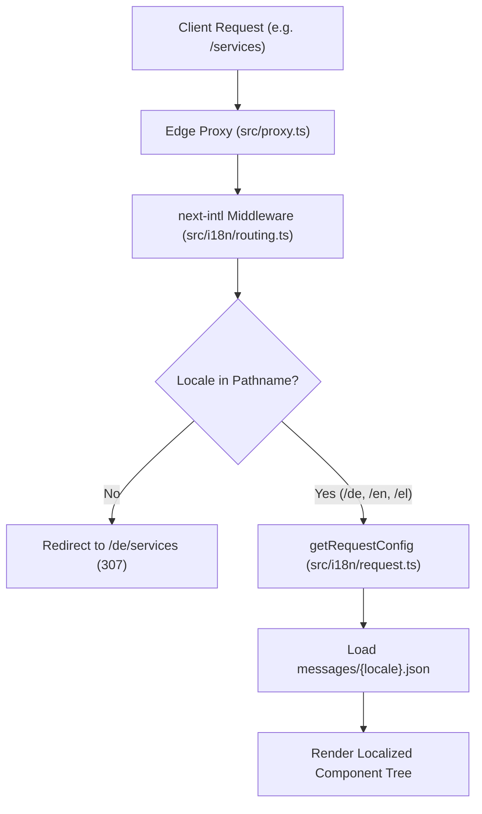

# 🌐 Internationalization (i18n) Architecture Guide

> **Core Engine**: `next-intl` (App Router Integration)  
> **Supported Locales**: German (`de` — Default), English (`en`), Greek (`el`)  
> **Route Strategy**: Strict Prefixing (`localePrefix: "always"`)  
> **Last Updated**: 2026-09-24

---

## 1. i18n Routing Architecture

LK Gloss & Detail implements full internationalization across all public and administrative interfaces. Route structure is governed by `next-intl` integrated directly into the Next.js 16 Edge Proxy (`src/proxy.ts`).



---

## 2. Configuration Files

### 2.1 Routing Definition (`src/i18n/routing.ts`)

Defines supported locales, default language, and custom navigation primitives:

```typescript
import { createNavigation } from "next-intl/navigation";
import { defineRouting } from "next-intl/routing";

export const routing = defineRouting({
	locales: ["de", "en", "el"],
	defaultLocale: "de",
	localePrefix: "always",
});

// Always use these navigation helpers for internal routing
export const { Link, usePathname, useRouter, redirect, getPathname } = createNavigation(routing);
```

### 2.2 Server Request Config (`src/i18n/request.ts`)

Dynamically imports message dictionaries per request:

```typescript
import { hasLocale } from "next-intl";
import { getRequestConfig } from "next-intl/server";
import { routing } from "./routing";

export default getRequestConfig(async ({ requestLocale }) => {
	const requested = await requestLocale;
	const locale = hasLocale(routing.locales, requested) ? requested : routing.defaultLocale;

	return {
		locale,
		messages: (await import(`../../messages/${locale}.json`)).default,
	};
});
```

---

## 3. Translation Dictionaries (`messages/*.json`)

Strings are organized into namespaces within three corresponding files:

- `messages/de.json` (German — primary source of truth)
- `messages/en.json` (English)
- `messages/el.json` (Greek)

### Dictionary Namespaces:

- `Metadata`: Site titles, descriptions, and OpenGraph defaults
- `Navigation`: Header links, mobile menu controls, CTA labels
- `HomePage`: Hero section, service highlights, USPs, B2B fleet banner
- `Assessment`: Photo upload wizard, swipe deck instructions, report labels
- `Booking`: Form steps, labels, calendar messages, success notifications
- `Chatbot`: Drawer headers, placeholder prompts, error states
- `Contact`: Contact form fields, business address, validation errors
- `Admin`: Sidebar items, appointments calendar, services CRUD, knowledge base hub
- `Legal`: Impressum, DSGVO privacy policies, cookie banner

> [!IMPORTANT]
> **Key Parity Rule**: When adding or updating a key in `de.json`, you **must** mirror the key path in `en.json` and `el.json`. Missing keys will trigger fallback warnings during rendering.

---

## 4. Usage in Components

### 4.1 Server Components (RSC)

Use `getTranslations` in asynchronous Server Components:

```typescript
import { getTranslations } from "next-intl/server";

interface PageProps {
  params: Promise<{ locale: string }>;
}

const ServicesPage: React.FC<PageProps> = async ({ params }) => {
  const { locale } = await params;
  const t = await getTranslations({ locale, namespace: "Services" });

  return <h1>{t("pageTitle")}</h1>;
};
```

### 4.2 Client Components

Use `useTranslations` in interactive client components:

```typescript
"use client";

import React from "react";
import { useTranslations } from "next-intl";

export const BookingProgress: React.FC = () => {
  const t = useTranslations("Booking.progress");

  return <span>{t("step1")}</span>;
};
```

### 4.3 Internal Navigation

Never use native HTML `<a>` tags or unlocalized Next.js `next/link` for internal pages. Always import `Link` from `@/i18n/routing`:

```typescript
import { Link } from "@/i18n/routing";

// Automatically resolves to /{locale}/booking
<Link href="/booking" className="btn-primary">
  {t("bookNow")}
</Link>
```

---

## 5. Dynamic Multilingual Content from Supabase

Database records (such as service titles and descriptions) store translations as JSONB objects:

```json
{
	"name": {
		"de": "Lackkorrektur & Versiegelung",
		"en": "Paint Correction & Ceramic Coating",
		"el": "Διόρθωση Χρώματος & Κεραμική Επίστρωση"
	}
}
```

### Localized Text Extraction Helper (`getLocalizedText`)

To safely display dynamic database content and handle potential edge cases (e.g., double-stringified JSON or missing translations), use `getLocalizedText` from `src/features/admin/types/servicesTypes.ts`:

```typescript
import { getLocalizedText } from "@/features/admin/types/servicesTypes";

// Safely extracts the active locale with fallback cascade:
// requested locale -> de -> en -> el -> first available value
const title = getLocalizedText(service.name, currentLocale);
```

---

## 6. SEO & hreflang Alternates

Internationalized metadata is dynamically created via `generateMetadata` in `app/[locale]/layout.tsx` and `app/sitemap.ts`:

- Emits `<link rel="alternate" hreflang="de" href="..." />`
- Emits `<link rel="alternate" hreflang="en" href="..." />`
- Emits `<link rel="alternate" hreflang="el" href="..." />`
- Emits `<link rel="alternate" hreflang="x-default" href=".../de" />`
