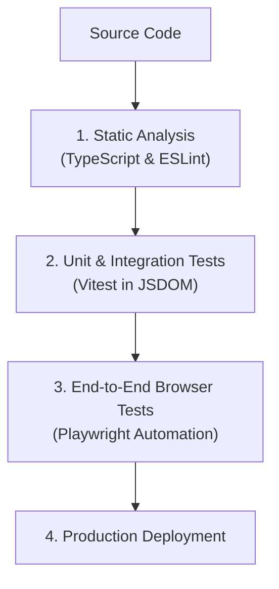
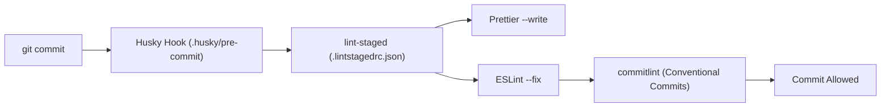

# 🧪 Testing & Quality Assurance (QA) Guide

> **QA Manual**: Vitest Unit Testing, Playwright End-to-End Automation, Linting, and Git Quality Hooks  
> **Target Audience**: Quality Engineers, Core Contributors, and Automation Bots  
> **Last Updated**: 2026-09-24

---

## 1. Testing Philosophy & Standards

LK Gloss & Detail employs a multi-tiered testing strategy ensuring reliability across booking concurrency, AI state pipelines, and visual UI components.

> [!IMPORTANT]
> **No Automatic Unit Tests Policy**:
> As per global engineering rules, AI assistants and automated tools must **never** write or generate unit tests automatically. Unit testing is performed exclusively upon explicit user command (e.g. `/qa` workflow or specific user prompt).



---

## 2. Unit & Integration Testing (Vitest)

Unit and integration tests run via [Vitest](https://vitest.dev/) with `jsdom` simulating browser APIs.

### 2.1 Configuration (`vitest.config.ts`)

- **Environment**: `jsdom`
- **Setup Script**: `./vitest.setup.ts` (configures `@testing-library/jest-dom`)
- **Path Resolution**: Maps `@/` directly to `./src`
- **File Matching**: `src/**/*.test.{ts,tsx}`

### 2.2 Test Suites Breakdown

- **Assessment Schema & Store Tests**:
  - `src/features/assessment/__tests__/assessmentSchema.test.ts`: Verifies Zod schemas, car size enums, dirt levels, and photo validation structures.
  - `src/features/assessment/__tests__/assessmentStore.test.ts`: Tests Zustand actions, swipe deck state transitions, and memory purging.
- **Booking Schema & Store Tests**:
  - `src/features/booking/__tests__/bookingSchema.test.ts`: Validates Step 1 client info schemas, email format checks, phone validation, and required GDPR consent.
  - `src/features/booking/__tests__/bookingStore.test.ts`: Verifies wizard navigation, pre-selected service detection from URL query parameters, and auto-skip logic.
- **Server Action Tests**:
  - `src/actions/__tests__/bookingActions.test.ts`: Mocks Supabase client to test atomic booking creation, unique date constraint violation handling (409 Conflict), and rollback mechanisms.

### 2.3 Executing Unit Tests

```bash
# Run all unit tests once
pnpm test

# Run tests in interactive watch mode
pnpm test:watch
```

---

## 3. End-to-End (E2E) Browser Testing (Playwright)

End-to-end browser automation is handled by [Playwright](https://playwright.dev/).

### 3.1 Device Coverage & Configuration (`playwright.config.ts`)

Simulates desktop browsers and mobile viewports:

- Desktop: **Chromium**, **Firefox**, **WebKit (Safari)**
- Mobile: **Mobile Chrome (Pixel 5)**, **Mobile Safari (iPhone 12)**
- Automatic WebServer: Launches `pnpm dev` automatically on `http://localhost:3000` before running tests.

### 3.2 E2E Test Scenarios (`e2e/`)

1. **Assessment Flow (`e2e/assessment-flow.spec.ts`)**:
   - Navigates to `/assessment`.
   - Uploads 4 test car photos (mocked base64).
   - Verifies angle validation success checkmarks.
   - Tests Tinder-style swipe cards (swipe left and swipe right actions).
   - Validates that the final report renders diagnostics and links to `/booking`.
2. **Booking Flow (`e2e/booking-flow.spec.ts`)**:
   - Fills out customer details in Step 1.
   - Verifies service selection in Step 2.
   - Verifies that booked/blocked dates are disabled in the Step 3 calendar.
   - Submits appointment and confirms redirection to `/booking/success?id=...`.
3. **Admin Flow (`e2e/admin-flow.spec.ts`)**:
   - Tests route protection: verifies unauthorized requests to `/admin` redirect to `/admin/login`.
   - Performs admin authentication.
   - Verifies calendar appointment rendering and services CRUD operations.

### 3.3 Executing E2E Tests

```bash
# Run all Playwright tests across all browser engines
pnpm test:e2e

# Run with interactive UI mode for debugging
pnpm playwright test --ui
```

---

## 4. Code Quality & Pre-Commit Pipeline

To maintain high code quality across team members, the repository enforces automated pre-commit checks:



### 4.1 Type Checking

```bash
pnpm typecheck
```

Executes `tsc --noEmit` across all TypeScript files. Any type mismatch or use of `any` triggers an immediate error.

### 4.2 Formatting & Linting

```bash
# Check code formatting
pnpm format:check

# Format files with Prettier & Tailwind sorting
pnpm format

# Run ESLint rules
pnpm lint
```

### 4.3 Conventional Commits (`commitlint`)

All commit messages must follow the [Conventional Commits](https://www.conventionalcommits.org/) specification:

- `feat: add WhatsApp floating button`
- `fix: resolve date parsing edge case in booking calendar`
- `docs: update database schema reference`
- `refactor: extract imageCompressor helper`
- `test: add assessment store unit tests`
